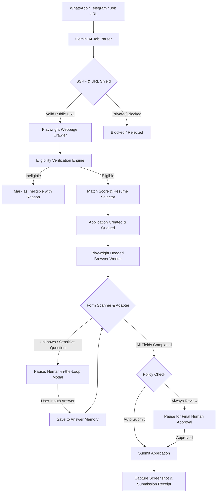

# ApplyPilot AI 🚀

> **Autonomous, Local-First Personal Job Application Agent powered by Google Gemini AI & Playwright**

[](https://nextjs.org/)
[](https://react.dev/)
[](https://www.typescriptlang.org/)
[](https://tailwindcss.com/)
[](https://playwright.dev/)
[](https://ai.google.dev/)
[](https://www.mongodb.com/)
[](https://vitest.dev/)
[](LICENSE)

---

## 🌟 Overview

**ApplyPilot AI** is a production-quality, local-first personal job application agent engineered for precision, privacy, and full human control. 

Applying to software and analytics positions often entails copy-pasting links across multiple job platforms, filling repetitive screening questions, tailoring resumes to specific roles, and verifying graduation criteria. **ApplyPilot AI** turns this chaos into an intelligent, automated pipeline:

1. **Ingests raw, unstructured alerts** from WhatsApp, Telegram, or LinkedIn.
2. **Crawls official career pages** (including complex single-page apps).
3. **Validates eligibility & calculates match scores** with deterministic constraints (e.g. graduation year, allowed degrees).
4. **Selects the optimal resume variant** from your repository.
5. **Autonomously fills ATS job applications** (Greenhouse, Lever, Ashby, and custom portals) in a headed Playwright browser session.
6. **Pauses for Human-in-the-Loop review** whenever sensitive questions (salary, visa, legal) or novel screening fields appear.

---

## ✨ Key Features

| Feature | Description |
| :--- | :--- |
| 📱 **Messy Alert Ingestion** | Extracts canonical URLs and extracts structured parameters from chaotic WhatsApp forwards, Hinglish text, emojis, and bullet points using Gemini 1.5 Flash structured schemas. |
| 🛡️ **SSRF Safety Shield** | Inspects all target URLs against DNS resolution, loopback (`127.0.0.1`), private RFC1918 subnets, and cloud metadata endpoints to prevent malicious exploits. |
| 🕷️ **Hydrated SPA Crawler** | Uses Playwright to render client-side JavaScript applications, extracting verified job specifications directly from official company portals. |
| 🎯 **Dynamic Eligibility Engine** | Enforces hard constraints (e.g., 2027 grad batch limits, minimum/maximum years of commercial experience, eligible degree branches) before any application is queued. |
| 📄 **Smart Multi-Resume Routing** | Automatically maps job requirements to tailored resume variants (e.g., Data Analyst, BI Analyst, AI/ML, Python Engineer, Full Stack). |
| 🤖 **Multi-ATS Form Adapters** | Tailored automation engines for major ATS platforms: **Greenhouse**, **Lever**, **Ashby**, plus a resilient **Generic Form Adapter** for custom application forms. |
| ✋ **Human-in-the-Loop Dialogue** | Flags unknown questions or sensitive fields (salary expectations, sponsorship status, background checks), captures live screenshots, and waits for user confirmation before proceeding. |
| 🧠 **Screening Answer Memory** | Remembers previously answered screening questions and auto-suggests or fills them in subsequent applications. |
| 📊 **Local-First Web Dashboard** | Full-featured Next.js UI providing live pipeline tracking, application analytics, activity audit logs, and profile management. |

---

## 🏗️ Architectural Workflow



---

## 💻 Tech Stack

- **Framework**: [Next.js 16](https://nextjs.org/) (App Router, Server Actions, Route Handlers)
- **Frontend**: [React 19](https://react.dev/), [Tailwind CSS v4](https://tailwindcss.com/), [Lucide React](https://lucide.dev/)
- **Language**: [TypeScript 5](https://www.typescriptlang.org/)
- **Database**: [MongoDB](https://www.mongodb.com/) via [Mongoose 9](https://mongoosejs.com/)
- **AI Engine**: [Google Cloud Vertex AI](https://cloud.google.com/vertex-ai) / [Gemini 1.5 Flash](https://ai.google.dev/)
- **Browser Automation**: [Playwright](https://playwright.dev/) (Headed Chromium with persistent user context)
- **Validation**: [Zod](https://zod.dev/)
- **Testing**: [Vitest](https://vitest.dev/)
- **Logging**: [Pino](https://github.com/pinojs/pino)

---

## 📁 Repository Structure

```text
ApplyPilot AI/
├── app/                              # Next.js App Router
│   ├── (dashboard)/                  # Authenticated Dashboard Views
│   │   ├── activity/                 # Live Activity Audit Logs
│   │   ├── applications/             # Job Applications Pipeline & Details
│   │   ├── dashboard/                # Main Overview & Analytics
│   │   ├── jobs/                     # Job Alert Ingestion & Parsing
│   │   ├── profile/                  # User Profile & Preferences
│   │   ├── questions/                # Answer Memory Knowledge Base
│   │   ├── resumes/                  # Resume Variants Manager
│   │   └── settings/                 # Automation & Approval Policies
│   ├── api/                          # REST Route Handlers
│   └── onboarding/                   # First-Time Wizard Flow
├── automation/                       # Browser Automation Core
│   └── adapters/                     # Platform-Specific Form Fillers
│       ├── AshbyAdapter.ts           # Ashby ATS Automation
│       ├── GenericFormAdapter.ts     # Heuristic Fallback Form Filler
│       ├── GreenhouseAdapter.ts      # Greenhouse Job Board Automation
│       ├── LeverAdapter.ts           # Lever Application Automation
│       └── types.ts                  # Adapter Interfaces & Contracts
├── lib/                              # Shared Utilities & Clients
│   ├── ai/                           # Gemini 1.5 Flash Client & Schemas
│   ├── db/                           # MongoDB Connection Manager
│   └── security/                     # SSRF Shield & URL Normalizer
├── models/                           # Mongoose Database Schemas
│   ├── ActivityLog.ts                # Real-Time Event Audit Log
│   ├── AnswerMemory.ts               # Screening Answer Repository
│   ├── Application.ts                # Job Application State Machine
│   ├── Job.ts                        # Parsed Job Metadata
│   ├── Resume.ts                     # Uploaded Resume Variants
│   ├── SystemSetting.ts              # Automation Toggles & Policies
│   └── UserProfile.ts                # Candidate Details & Preferences
├── schemas/                          # Zod Schemas & Types
├── scripts/                          # Background Daemons
│   └── worker.ts                     # Headed Playwright Worker Process
├── storage/                          # Local Storage (Excluded from Git)
│   ├── browser-profile/              # Persistent Chromium Cookies/Session
│   ├── resumes/                      # User Resumes (.pdf)
│   └── screenshots/                  # Evidence & Pause Snapshots
├── tests/                            # Test Suite
│   ├── e2e/                          # End-to-End Automation Tests
│   ├── fixtures/                     # Mock ATS Server for Local Testing
│   └── unit/                         # Unit Tests (SSRF, Parsing, Matching)
├── .env.example                      # Environment Configuration Template
├── credentials.example.json          # GCP Service Account Template
├── package.json                      # Dependencies & Scripts
├── tsconfig.json                     # TypeScript Configuration
└── LICENSE                           # MIT License
```

---

## ⚡ Quick Start Guide

### 1. Prerequisites

- **Node.js**: v20.x or higher installed ([Download Node.js](https://nodejs.org/))
- **MongoDB**: Local MongoDB instance or free [MongoDB Atlas](https://www.mongodb.com/atlas) cluster
- **Google Cloud / Gemini API**: Gemini API key or GCP Service Account credentials

### 2. Clone the Repository

```bash
git clone https://github.com/KrishnaTanwars/ApplyPilot_AI.git
cd ApplyPilot_AI
```

### 3. Install Dependencies

```bash
npm install
```

### 4. Install Playwright Browsers

```bash
npx playwright install chromium
```

### 5. Configure Environment Variables

Create your `.env` file from the template:

```bash
# On Windows PowerShell:
Copy-Item -Path .env.example -Destination .env

# On Linux / macOS:
cp .env.example .env
```

Edit `.env` with your values:

```env
# MongoDB Connection URI
MONGODB_URI=mongodb://localhost:27017/applypilot

# Google Gemini / Vertex AI Configuration
GEMINI_API_KEY=your_gemini_api_key_here
GOOGLE_CLOUD_PROJECT=your-gcp-project-id
GOOGLE_CLOUD_LOCATION=us-central1

# Application Base URL
APP_URL=http://localhost:3000

# Security Secrets
SESSION_SECRET=your_random_secret_string
ENCRYPTION_KEY=0123456789abcdef0123456789abcdef0123456789abcdef0123456789abcdef

# Local Storage Folders
BROWSER_PROFILE_DIR=./storage/browser-profile
RESUME_STORAGE_DIR=./storage/resumes
SCREENSHOT_STORAGE_DIR=./storage/screenshots

# Log Level
LOG_LEVEL=info
```

---

## 🚀 Running ApplyPilot AI

ApplyPilot AI operates with two synchronized processes:
1. **The Web Dashboard**: Manage applications, parse alerts, and respond to human-in-the-loop prompts.
2. **The Automation Worker**: Runs headed Chromium browser sessions to fill applications.

### Terminal 1: Next.js Web Dashboard

```bash
npm run dev
```
Open **[http://localhost:3000](http://localhost:3000)** in your browser. On your first visit, the onboarding wizard will guide you through setting up your profile, preferences, and resumes.

### Terminal 2: Automation Worker

```bash
npm run worker
```
The worker monitors queued applications, opens a headed Chromium session, applies matching profile data, and halts for confirmation whenever needed.

### Optional: Offline Mock ATS Server

To safely test the entire pipeline without submitting live applications to real employers, launch the local mock ATS server:

```bash
npm run mock-server
# Runs mock Greenhouse/Lever/Ashby sandbox forms on http://localhost:3001
```

---

## 🧪 Testing & Verification

Run the comprehensive unit and integration test suite:

```bash
# Run Vitest test suite
npm run test

# Run Next.js production build check
npm run build

# Run code linter
npm run lint
```

---

## 🛡️ Privacy, Security & Responsible Automation

- **Local-First Architecture**: Your resumes, session cookies, and personal answers remain stored locally on your machine.
- **SSRF Shield**: All incoming URLs are inspected to guarantee requests are strictly routed to public internet domains, avoiding private network scanning.
- **Human In The Loop**: Sensitive legal disclosures, salary negotiations, and compliance questions require manual review.
- **Ethical Automation**: ApplyPilot AI is designed to assist candidates with tedious repetitive data entry, not to spam job boards. Always review applications before submission.

---

## 📄 License

This project is licensed under the **MIT License** — see the [LICENSE](LICENSE) file for details.

---

## 👤 Author

**Krishna Tanwar**
- GitHub: [@KrishnaTanwars](https://github.com/KrishnaTanwars)
